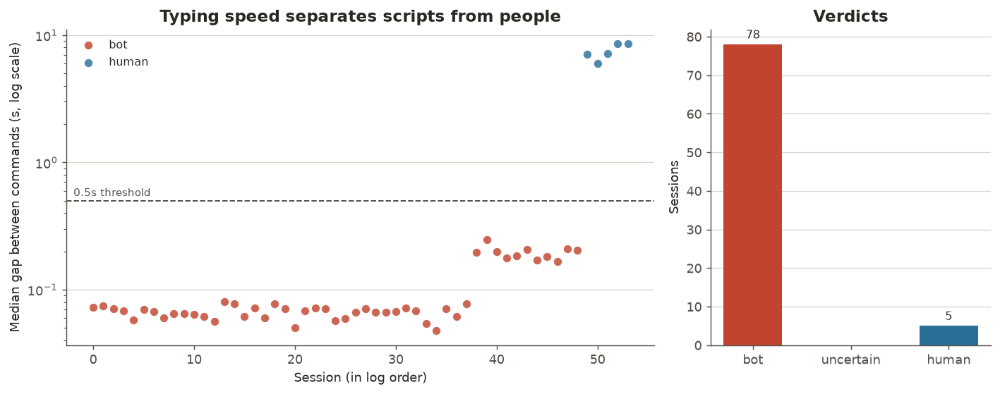
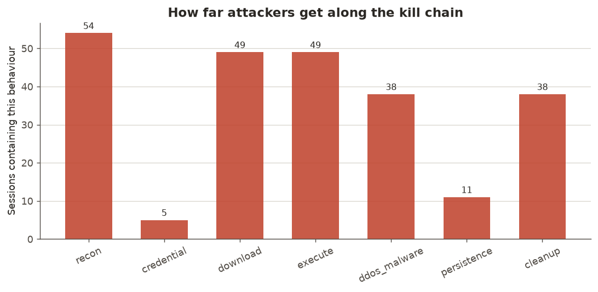
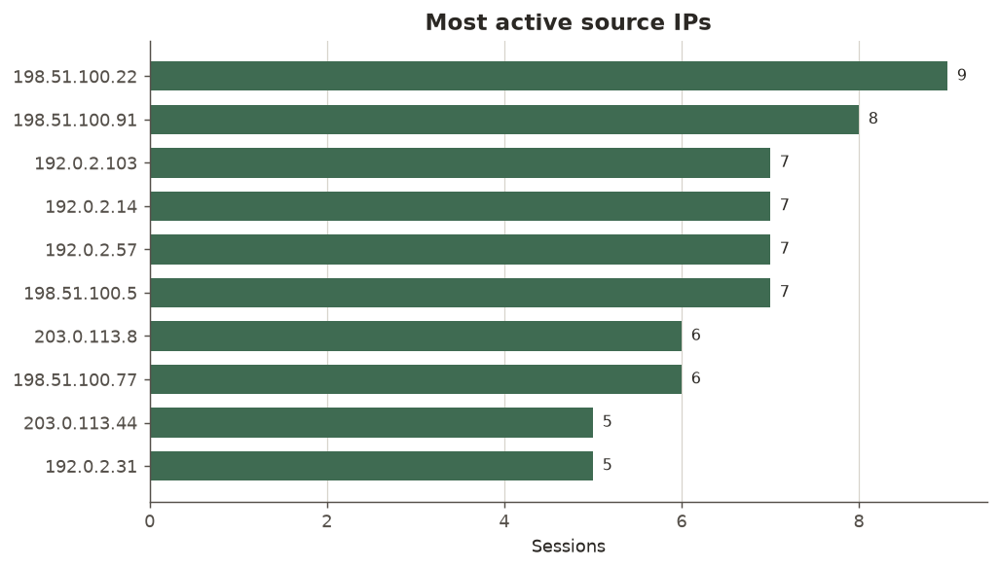

# SSH Honeypot & Telemetry

A low-interaction SSH honeypot that impersonates a vulnerable Linux server,
records everything an attacker does, and analyses the resulting logs for
behavioural patterns — including whether each session was driven by a script or
by a person at a keyboard.

Built for the Mozilla Firefox Club VIT technical recruitment (Cyber-Sec track).

---

## What it does

| Requirement | Where it lives |
|---|---|
| Log attacker IPs, timestamps, session summaries, every command | `honeypot.py` → `event_log.py` |
| Extract attempted URLs and malicious scripts/commands | `analyze.py` (regex extraction + intent tagging) |
| Telemetry: IP frequency, common commands, bot vs human | `analyze.py` (behavioural scoring) |
| Charts and graphs (bonus) | `visualize.py` (5 PNGs) |

---

## Quick start

```bash
pip install -r requirements.txt

# Terminal 1 — start the honeypot
python3 honeypot.py

# Terminal 2 — attack it yourself
ssh -p 2222 root@localhost          # any password works
# type: whoami, uname -a, wget http://example.com/x.sh, exit

# Terminal 2 — see what it caught
python3 analyze.py
python3 visualize.py
```

Charts land in `output/`. Logs land in `logs/honeypot.jsonl`.

### Seeing results without exposing a server

A honeypot collects nothing until it is reachable from the internet. To
demonstrate and test the analysis pipeline immediately there is a generator that
writes a log in the exact format the honeypot produces, modelled on real SSH
attack patterns:

```bash
python3 simulate_attacks.py
python3 analyze.py   --log logs/sample_attacks.jsonl
python3 visualize.py --log logs/sample_attacks.jsonl
```

This data is clearly labelled as synthetic everywhere it appears. Every source
IP in it is from an RFC 5737 documentation range, which cannot be routed on the
public internet — so no real host is implicated by the sample.

---

## Files

```
honeypot.py          The SSH listener. Real SSH protocol, fake machine behind it.
fake_shell.py        The illusion: canned responses for ~25 commands. Executes nothing.
event_log.py         Structured JSONL logging. The only module that writes to disk.
analyze.py           Log parsing, payload extraction, bot/human scoring, terminal report.
visualize.py         Five matplotlib charts.
simulate_attacks.py  Generates realistic sample logs for testing and demos.
```

Read them in that order — each one only depends on the ones above it.

---

## How it works

```
   attacker
      |  TCP :2222
      v
 ┌──────────────────┐
 │  honeypot.py     │  socket accept, one thread per connection
 │                  │
 │  paramiko        │  real SSH handshake, key exchange, encryption
 │  Transport       │
 │                  │
 │  HoneypotServer  │  policy: accept every password, log it
 │                  │
 │  shell_session() │  echo keystrokes, capture each submitted line
 └────────┬─────────┘
          │  every event
          v
   logs/honeypot.jsonl        ← append-only, one JSON object per line
          │
          v
 ┌──────────────────┐
 │  analyze.py      │  group events into sessions, extract URLs,
 │                  │  tag intent, score bot-vs-human
 └────────┬─────────┘
          │
    ┌─────┴─────┐
    v           v
 terminal    visualize.py → output/*.png
 report
```

### The safety model

`fake_shell.py` contains no `subprocess`, no `os.system`, no `eval`. Every
response is a hardcoded string looked up from a dictionary. There is no code
path from attacker input to execution — which is what separates a honeypot from
a remote shell you handed to a stranger.

That is the defining trade-off of a **low-interaction** honeypot: it cannot be
used to harm anyone, it is safe to run anywhere, and a careful attacker spots
the fake within a few commands. For capturing automated scanner behaviour —
which is the overwhelming majority of SSH attack traffic — that is the right
trade, because scanners never check.

Two further containment decisions:
- Port forwarding channels are refused outright (`check_channel_request`), so
  the honeypot cannot be used to tunnel traffic to a third party.
- It binds to **2222**, not 22, so it never needs to run as root. In a real
  deployment you redirect at the firewall instead:
  `iptables -t nat -A PREROUTING -p tcp --dport 22 -j REDIRECT --to 2222`

### Bot vs human detection

Six weighted signals, summed into a score. Positive means automation:

| Signal | Weight | Reasoning |
|---|---|---|
| Median gap between commands < 0.5s | +2 | Faster than anyone can type |
| Median gap > 2.0s | −2 | Consistent with reading output and thinking |
| Any backspaces | −2 | Scripts never make typos |
| Client banner is a library (libssh, Go, paramiko) | +2 | Not an interactive terminal |
| Client banner is OpenSSH/PuTTY | −1 | What a person actually uses |
| Gap variance < 0.15s | +1 | Machine-regular rhythm |
| Gap variance > 1.5s | −1 | Irregular, human-like |

Score ≥ 2 → bot. Score ≤ −2 → human. Anything between → uncertain, reported
honestly rather than forced into a bucket.

This is a transparent rule set, not a trained model, and that is deliberate:
there is no labelled ground truth here — nobody tells us who was really a bot —
so a trained classifier would be unverifiable. Every verdict this produces
carries its reasons attached, so it can be inspected and argued with.

The evidence that the signal is real is `output/bot_detection.png`: sessions
separate into distinct clusters with a wide empty gap between them. If they
smeared into one blob, the threshold would be arbitrary.

---

## Known limitations

Stated plainly, because they are the honest boundary of what was built:

1. **Accepting every password is detectable.** A scanner that deliberately tries
   an absurd credential to fingerprint honeypots sees it accepted and knows.
   Rejecting the first N attempts before accepting would make the login look
   earned. This is the first thing I would add.
2. **The fake filesystem has no state.** `cd /tmp` then `ls` still shows `/root`.
   Any attacker who checks spots it immediately.
3. **Commands are matched by prefix, not parsed.** `wget` inside a quoted string
   is still tagged as a download. A real shell-syntax parser would fix this.
4. **No geolocation or threat-intel enrichment.** IPs are reported as raw
   addresses. Joining against MaxMind GeoLite2 or AbuseIPDB would turn the IP
   list into something actionable.
5. **Single-node.** Multiple sensors writing to one collector would show whether
   the same botnet sweeps different networks on a schedule.

## Possible extensions

- Reject the first few logins so credentials look earned
- Stateful fake filesystem (track cwd, allow file creation in `/tmp`)
- Actually fetch and hash captured payload URLs in a sandbox, submit to VirusTotal
- Geolocation + ASN enrichment on source IPs
- Live dashboard instead of static PNGs
- Session clustering to identify distinct botnet families by command fingerprint

---

## Requirements

Python 3.8+, `paramiko` (SSH protocol), `matplotlib` (charts). Nothing else.

## Legal note

Run this only on infrastructure you own or are authorised to operate. A
honeypot records data about people who connect to it; depending on jurisdiction
and deployment that can carry logging and privacy obligations. The sample data
included here is synthetic.

---

## Results



Sessions split into two populations: automated tooling fires commands ~0.07s
apart, humans pause 6-9s to read output. That separation is what the classifier
keys on, and the clusters do not overlap.



Download and execute are equal — fully automated attacks have no decision point
between fetching a payload and running it. The five-session gap at `recon` is
the human operators, who looked around and left without dropping anything.



Five of those addresses run a byte-identical command chain, so they are one
actor on five machines rather than five attackers.

Full analysis in [TELEMETRY_REPORT.md](TELEMETRY_REPORT.md).
